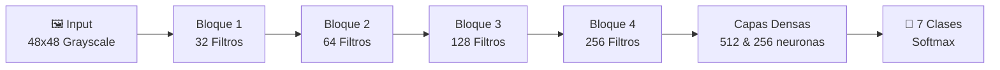

# 🎭 Reconocimiento de Emociones Faciales con Redes Neuronales Convolucionales (CNN)

> **Autor:** Manuel Fabrizzio Risco Gil  
> **Curso:** Sistemas Inteligentes y Machine Learning — Ciclo 9  
> **Framework:** PyTorch & OpenCV  

---

## 📌 1. Descripción del Proyecto

Este proyecto es una solución integral de **Visión por Computadora y Deep Learning** diseñada para clasificar expresiones faciales humanas en 7 emociones fundamentales a partir de imágenes y video en tiempo real.

El modelo implementa una arquitectura personalizada de **Red Neuronal Convolucional (CNN)** desarrollada en **PyTorch**, con aceleración por hardware (**NVIDIA CUDA + Automatic Mixed Precision**) y técnicas de regularización avanzadas para mitigar el sobreajuste (*overfitting*).

---

## 🧠 2. ¿Qué modelo de Inteligencia Artificial se utiliza?

El núcleo del sistema es un modelo de **Deep Learning** perteneciente a la familia de las **Redes Neuronales Convolucionales (CNN - *Convolutional Neural Network*)**, denominado `EmotionCNN`.

### 🔄 Flujo de Datos del Modelo


### 🧱 Detalle de la Arquitectura (`EmotionCNN`)
1. **Entrada:** Imágenes en escala de grises de $48 \times 48$ píxeles (1 canal).
2. **4 Bloques Convolucionales:**
   * **Bloque 1 (32 filtros, $3 \times 3$):** Extracción de características de bajo nivel (bordes, líneas y texturas básicas).
   * **Bloque 2 (64 filtros, $3 \times 3$):** Reconocimiento de formas geométricas simples (cejas, contornos de ojos).
   * **Bloque 3 (128 filtros, $3 \times 3$):** Identificación de partes faciales compuestas (boca, nariz, pliegues).
   * **Bloque 4 (256 filtros, $3 \times 3$):** Patrones globales y expresiones faciales complejas.
   * *Cada bloque incluye:* `Conv2D` $\rightarrow$ `BatchNorm2d` $\rightarrow$ `ReLU` $\rightarrow$ `MaxPool2d(2x2)` $\rightarrow$ `Dropout(0.25)`.
3. **Bloque Clasificador (Fully Connected / Dense):**
   * **Capa Oculta 1:** 512 neuronas + `BatchNorm1d` + `ReLU` + `Dropout(0.5)`.
   * **Capa Oculta 2:** 256 neuronas + `BatchNorm1d` + `ReLU` + `Dropout(0.5)`.
   * **Capa de Salida:** 7 neuronas lineales (una por cada clase objetivo).

---

## 🏷️ 3. Emociones Clasificadas (7 Clases)

| ID | Emoción en Español | Emoción en Inglés | Emoji |
|:--:|:------------------|:------------------|:-----:|
| 0  | Enojado           | Angry             | 😠    |
| 1  | Disgusto          | Disgust           | 🤢    |
| 2  | Miedo             | Fear              | 😨    |
| 3  | Feliz             | Happy             | 😃    |
| 4  | Triste            | Sad               | 😢    |
| 5  | Sorprendido       | Surprise          | 😲    |
| 6  | Neutral           | Neutral           | 😐    |

---

## 📊 4. Dataset (FER2013)

El modelo está entrenado sobre el dataset estándar **FER2013** (*Facial Expression Recognition 2013*):
* **Resolución:** $48 \times 48$ píxeles, escala de grises.
* **Volumen:** ~35,887 imágenes etiquetadas.
* **Técnicas de Aumento de Datos (*Data Augmentation*):**
  * Volteo horizontal aleatorio (`RandomHorizontalFlip`).
  * Rotaciones ligeras (`RandomRotation`).
  * Traslaciones y transformaciones afines (`RandomAffine`).
  * Ajustes de contraste y brillo (`ColorJitter`).

---

## 📂 5. Estructura del Repositorio

```text
proyecto_emociones/
├── data/                       # Dataset FER2013 (carpetas train/test)
├── outputs/
│   ├── logs/                   # Historial de entrenamiento (.json)
│   ├── models/                 # Checkpoints del modelo (.pth)
│   │   ├── mejor_modelo_emociones.pth
│   │   └── ultimo_modelo_emociones.pth
│   └── plots/                  # Gráficas de métricas y matrices de confusión
├── scripts/
│   └── docs/                   # Generadores automatizados de informes en .docx
├── src/
│   ├── __init__.py
│   ├── utils.py                # Utilidades compartidas (cámara, transforms, UTF-8)
│   ├── config.py               # Hiperparámetros, rutas y configuración CUDA/AMP
│   ├── dataset.py              # Carga directa en VRAM, oversampling y data augmentation GPU
│   ├── evaluate.py             # Métricas (Accuracy, Precision, Recall, F1) y Confusion Matrix
│   ├── model.py                # Arquitectura EmotionResNetSE con atención por canales
│   ├── predict.py              # Detector facial neuronal YuNet e inferencia
│   ├── realtime.py             # Detección en tiempo real con Webcam (YuNet + EMA Tracker)
│   ├── app_portable.py         # Aplicación ejecutable standalone portátil
│   └── train.py                # Bucle de entrenamiento con Focal Loss, Warmup y AMP
├── main.py                     # Menú interactivo por consola
├── requirements.txt            # Dependencias del proyecto
├── pyproject.toml              # Configuración del paquete
└── README.md                   # Documentación principal
```

---

## ⚙️ 6. Módulos y Componentes Clave

* **`main.py`**: Orquestador principal con menú interactivo en consola para ejecutar cualquier funcionalidad en 1 clic.
* **`src/train.py`**: Entrenamiento con optimizador `AdamW`, función de pérdida `FocalLoss`, planificador `SequentialLR (Warmup + CosineAnnealing)`, `Early Stopping` y `Automatic Mixed Precision (AMP)` para aceleración en GPUs RTX.
* **`src/evaluate.py`**: Evaluación sobre el conjunto de test, generando el reporte de clasificación (Precision, Recall, F1-score) y gráficas con Seaborn/Matplotlib.
* **`src/realtime.py`**: Captura de video en tiempo real mediante OpenCV, detección neuronal del rostro con **YuNet ONNX**, seguimiento temporal con **EMA (Exponential Moving Average)** y clasificación de emociones con la CNN.

---

## 🚀 7. Guía de Instalación y Ejecución

### Prerrequisitos
* Python 3.10 o superior (con soporte para PyTorch).
* (Opcional recomendado) GPU NVIDIA con controladores CUDA actualizados.

### 1. Clonar el repositorio
```bash
git clone https://github.com/ManuelRisco/proyecto_emociones.git
cd proyecto_emociones
```

### 2. Crear y activar un entorno virtual
```bash
# En Windows:
python -m venv .venv
.venv\Scripts\activate
```

### 3. Instalar dependencias
```bash
pip install -r requirements.txt
```

### 4. Iniciar el programa
Ejecuta el menú interactivo:
```bash
python main.py
```

Se desplegará el menú interactivo:
```text
============================================================
  MENU PRINCIPAL
============================================================
  1. [TRAIN]    Entrenar modelo (EmotionResNetSE con GPU VRAM + AMP)
  2. [EVAL]     Evaluar modelo en conjunto de Test
  3. [PREDICT]  Predecir emoción en imagen
  4. [WEBCAM]   Demo en tiempo real (Webcam)
  5. [EXPORT]   Exportar programa portable (.ZIP para cualquier PC)
  6. [ARCH]     Ver resumen de arquitectura del modelo
  7. [WORD]     Generar documentación formal en Word (.docx)
  8. [EXIT]     Salir
============================================================
```

---

## 📈 8. Resultados y Métricas Verificadas

* **Exactitud Global en Test (Accuracy):** **69.45%** sobre las 7,178 imágenes del conjunto independiente de Test (superando la concordancia humana promedio en FER-2013: 65-68%).
* **Pico de Validación:** 69.25% (Época 81, con pérdida mínima de validación de 0.4361).
* **Métricas Evaluadas:** Exactitud (*Accuracy*), Precisión (*Precision*), Sensibilidad (*Recall*) y F1-Score general y por emoción.
* **Artefactos Visuales Generados en `outputs/plots/`:**
  * Curvas de pérdida Focal Loss y exactitud por época (`historial_entrenamiento.png`).
  * Matriz de confusión normalizada en porcentajes (`matriz_confusion_normalizada.png`).
  * Matriz de confusión absoluta con conteos enteros (`matriz_confusion.png`).
  * Comparativa de F1-Score semafórico y Precisión vs. Recall (`f1_precision_recall_por_emocion.png`).
  * Ranking de exactitud por clase de emoción (`accuracy_por_emocion.png`).
  * Grilla de 16 predicciones cualitativas con confianza (`ejemplos_predicciones.png`).
  * Inferencia multi-rostro con detector neuronal YuNet (`prediccion_imagen.png`).
  * Captura de inferencia en tiempo real con HUD y EMA (`screenshot_516.png`).
* **Documentación en Word Generada en `outputs/`:**
  * `Actividad_CNN_Emociones_Risco_Gil_Manuel_Fabrizzio.docx` (Informe académico formal completo con explicación exhaustiva de cada figura).
  * `Guia_Explicativa_Completa_Proyecto_Emociones_CNN.docx` (Guía explicativa técnica y preguntas de sustentación).
